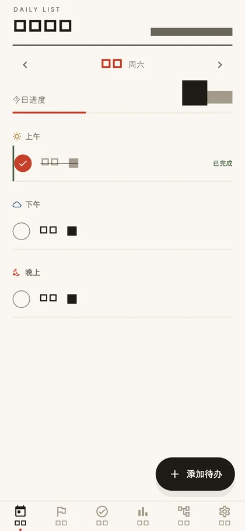
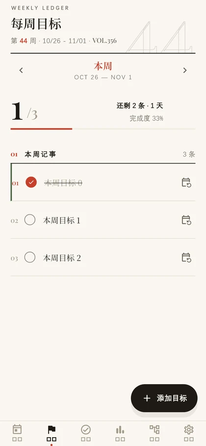
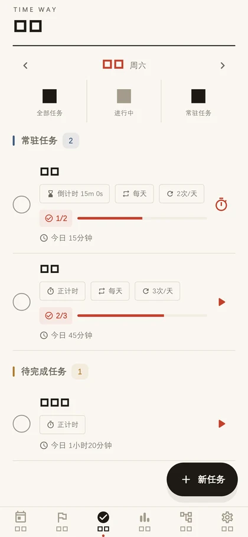
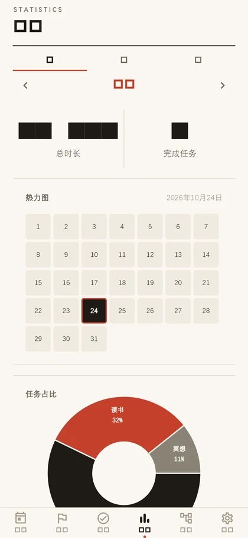

<div align="center">


# 时途 TimeWayPro

**时间规划与人生规划助手**

给任务计时 · 记录真实用时 · 看清时间去向

[](https://flutter.dev)
[](https://dart.dev)
[](#环境要求)
[](#版本迭代)
[](https://github.com/yanxu5656/TimeWayPro/releases)

<p>
  
  
  
  
  
</p>

</div>

---

## 简介

TimeWayPro（中文名「时途」）是一款基于 Flutter 开发的时间管理应用。

它的核心逻辑很简单：**给任务计时 → 把每一段实际用时记录下来 → 用统计图表告诉你时间究竟花在了哪里**。在此之上，再挂载「人生规划」的目标树、「每周目标」与「每日待办」的轻量清单，兼顾长期方向、每周节奏与当天执行。

与常见的待办清单不同，时途不满足于「打勾」，而是记录**每件事真实消耗了多少时间** —— 这些记录会沉淀为热力图、饼图和任务明细，让「我很忙」变成「我忙在了这件事上，一共 3 小时 20 分」。

界面在 1.5.0 重做为**静白志**（纸白编辑排版风）：纸白底、墨色文字、朱砂一笔，细线分层、衬线数字当主角。设计取舍写在下面的[设计系统](#设计系统)一节。

---

## 安装

到 [**Releases**](https://github.com/yanxu5656/TimeWayPro/releases) 下载最新版本的 APK（文件名带版本号，形如 `app-release-1.4.0.apk`），直接装到手机上即可。

**环境要求**：Android 7.0（API 24）及以上。

> ⚠️ 目前的安装包用的是 Flutter 默认的**调试签名**。自己侧载完全没问题，但**不能上架应用商店**；而且如果之后换了签名，覆盖安装会失败（需要先卸载旧版）。
>
> 想自己构建见下面的[快速开始](#快速开始)。

---

## 功能特性

### ⏱ 任务 · 计时

应用的核心模块。

- **两种计时模式** —— 正计时记录实际耗时；倒计时到点自动完成任务
- **多任务并行计时** —— 多个任务可同时处于计时状态，互不干扰
- **后台计时与状态恢复** —— 计时状态持久化，杀掉 App 后重启自动恢复并继续；超过 24 小时的异常计时自动归档
- **暂停 / 继续** —— 中途暂停，恢复后继续累计
- **重复任务** —— 不重复 / 每天 / 每周 / 每月，可设每日重复次数，跨天自动重置完成次数
- **截止日期与提前提醒**
- **计时记录** —— 每次计时生成一条独立记录（开始 / 结束 / 时长），作为统计模块的数据源

### 📊 统计

- **日 / 周 / 月**三个维度切换，支持前后翻页与直接选日期查看历史
- **概览** —— 区间总时长、完成任务数（切日期时数字滚动）
- **热力图** —— 按月着色，日模式下展示整月网格并高亮当前选中日
- **任务占比饼图** —— 各任务耗时占比，切片标签按底色亮度自动择色
- **任务明细** —— 按耗时排序的列表与占比进度条

### 🎯 人生规划

- **任意层级的目标树** —— 目标可无限层级向下拆分（大目标 → 阶段 → 具体事项）
- **进度管理** —— 每个节点独立调整进度（0% ~ 100%），进度条按区间着色
- **树状图展示** —— 层级以缩进 + 色条呈现
- **级联删除** —— 删除父目标时递归清理所有子目标

### 📝 每日待办

- **独立于任务模块的轻量清单** —— 按日期存储，适合当天临时事项
- **时间段分类** —— 上午 / 下午 / 晚上三段分组，添加时自动定位当前时段
- **完成进度** —— 点击圆圈勾选，顶部进度条实时显示今日完成度
- **滑动删除**（带二次确认）与**长按编辑**

### 🏁 每周目标

- **独立的「每周」Tab** —— 与每日待办平行的周视角，待办页回归纯「当天」
- **任意周访问** —— 左右箭头翻周、直接选日期跳周，翻走后一键「回到本周」；旧周数据完整可回看
- **提前规划下周** —— 翻到任意周后添加，目标就落在那一周
- **快捷挪周** —— 每条目标行尾的挪动按钮打开快捷面板：上周 / 本周 / 下周 / 下下周（各带日期区间）一键挪，更远的周走日期选择器；挪动排在目标周队尾，不动它原有的顺序
- **勾选进度** —— 逐条勾选，概览进度条实时显示完成度，满额变绿

### ☁️ 数据同步与备份

- **坚果云 WebDAV 同步** —— 一键备份 / 恢复，配置步骤见[下文](#坚果云同步配置)
- **本地导入导出** —— 导出为 JSON 文件、从 JSON 文件导入
- **自动备份与原子写入** —— 写入走临时文件 + 改名替换，中断也不会写出半截 JSON；正式文件异常时自动从 `.bak` 回滚

### 🔔 通知栏常驻通知

- 计时进行中在通知栏常驻显示任务名称与计时，每 5 秒更新
- App 被杀死后重启，通知自动恢复

---

## 版本迭代

### v1.6.0 — 编排精修
*2026-10-31*

**动机**：静白志用下来方向对了，但「素」了些、部分排布不够优雅。对比四个升级方向（暖笺文武线 / 浮笺卡片 / 玄墨对页 / 编排精修）后选定**编排精修**——颜色几乎不动，专治排布：字号对比、元信息收拢、区块编号、间距节奏。

**排版系统（全部六页统一）**

- **刊头水印**：右上角当周 ISO 周号 / 当日日期的巨号描边空心数字（132px Playfair，墨色 13%），被铅线裁切——素纸面有了体量锚点
- **元信息行**：原先散落的 期号 / 年月 / 周号 / 计数 收拢成标题下一行间隔号分节的 meta（`第 44 周 · 10/19 - 10/25 · VOL.359`），关键数字朱砂
- **编号区块**：每个内容区块一个衬线朱砂序号 + 拉字距小标 + 右对齐计数（`01 · 本周记事 · 3 条`），下缘重规线与发丝行线形成粗细节奏
- **大分数**：每周 64px、待办 48px、任务统计条 30px，右侧配「还剩 X 条 · 距周末 X 天 / 完成度 Z%」两行小注
- **周行日期改英文大写**（`OCT 19 — OCT 25`），与眉题同一套编辑语言；`week.dart` 新增 `isoWeekNumber`（周四定年定周，跨年 53 周有测试）
- **间距放宽**：账本行 14 → 17px，区块间距统一

**各页落点**：每周（水印 44 + 全套）；待办（水印日期 + 上午/下午/晚上 编号化）；任务（水印 + meta 带计时中计数 + 统计数字放大 + 三区块编号）；统计（热力图/占比/明细 编号化，右侧带计数）；规划（meta 带总数与平均进度 + 目标树区块头）；设置（三组编号化，右侧带连接状态与版本号）；挪周弹窗改编号账本行。

**边界**：纯排版层——不动组件 API、不动配色、不动交互与数据层。

### v1.5.1 — 收尾：图标、健壮性与安全修复
*2026-10-24*

**应用图标**——重做为静白志风：纸白平涂底 + 墨色不闭合圆环 + 缺口端点的朱砂圆点（当下），与 app 内的墨圈朱砂勾选是同一套语言。`tool/make_app_icon.py` 改参数重跑即得全套平台资源。

**健壮性**（全面代码核查的产出，按严重度）：

- **写盘串行化**：`DatabaseHelper` 加写队列——原先两条写链交错时会争用同一个 `.tmp` 文件（测试日志里的 errno 32 就是它），坏的序列甚至让正式文件处于缺失状态。同时落盘失败不再被吞掉，「恢复成功」的提示不会再与磁盘实际状态不符
- **多计时器通知错乱**：停掉并行计时之一后，通知栏会被已停止任务的旧更新器刷回去且永不恢复——现在停止/恢复计时都会重绑通知的周期更新器
- **停止计时的记录污染**：找不到本次会话的记录时（如计时中做了数据恢复），原先会回退改写该任务**最旧**的一条历史记录——现在放弃更新而不是污染
- **恢复/导入的完整刷新**：原先只重载任务/规划两个 provider，待办与每周页在 IndexedStack 保活下继续显示旧数据、幽灵操作静默失败——现在先停掉所有计时器再四个 provider 全量重载
- **导入竞态**：冷启动后立即导入可能被在途的磁盘读取整体覆盖回去——`importAll` 先等初始化落地
- **双击开始计时**：异步空窗会插入两条记录并泄漏一个每秒 tick 的孤儿 Timer——加同步占位防抖
- **日期运算 DST 修正**：周/日导航改构造函数日运算，夏令时区不再跳周/跳日
- **统计区间改半开**：闭区间 `23:59:59` 会漏掉最后一秒内开始的记录
- **行级容错**：单条脏数据（旧备份缺字段）不再让整页列表静默消失

**安全**：`exportAll` 不再随数据导出坚果云**应用密码**（原先备份文件与导出文件里是明文）。恢复旧备份后需要在设置里重新输入密码。

**一致性**：九个底部弹窗标题统一为衬线（原先 16/18/20px 三种并存）；同步状态卡改浮起白卡（raised 档）；分段控件未选中色从 textHint 修正为 textSecondary（对比度硬规则）；每周页期号对锚点前的周做了防御。

**已知留白**（低风险，暂不处理）：多计时器时每秒多次 `notifyListeners` 的整页重建开销；计时中编辑倒计时时长已即时生效，但通知总时长取值路径仍有缓存；明文凭据仍存本地 JSON（仅不再外流）。

### v1.5.0 — 静白志（全面 UI 迭代）
*2026-10-24*

**动机**：极光玻璃用了几个版本后觉得「不够大气」。对比了四个方向（曜石金 / 静白志 / 极光 2.0 / 云墨）后选定**静白志**——纸白编辑排版风，高级感来自排版与克制，不靠特效。

**视觉语言**

- **三种材料**：纸（`#FAF7F1` 底）、墨（`#1D1A14` 文字与操作色）、朱砂（`#C5402C`，全应用唯一强调色）
- **衬线字体打包**：Playfair（数字主角：1/3、时长、统计大数字）+ 思源宋子集（刊头、账本行），`tool/subset_fonts.py` 生成，合计约 3.3MB
- **刊头制**：每页顶部是眉题（DAILY LIST / WEEKLY LEDGER…）+ 衬线大标题 + 铅线，标题属于内容而非 chrome
- **账本行**：列表一律细线分隔的行（row 档只有下缘发丝线，强调态左缘 2.5px 着重线），卡片退位
- **大分数**：完成度用 40px+ 衬线数字呈现，数字是页面的主角
- **性能红利**：`BackdropFilter`、渐变描边、极光层全部移除——「按帧耗降档」防的两项重负载不复存在，中低端机直接受益

**工程**

- 组件层整体改名：`Glass*` → `Paper*`（`glass.dart` → `paper.dart` barrel），表面档位 flat / row / ruled / raised
- 令牌层换血但**骨架不动**：全部令牌名保持，页面零改名成本；统计页图表只换了三个色板常量
- 对比度护栏更新为纸面体系（墨 16.1:1 AAA / 次级 5.3:1 AA / 提示仅装饰 / 朱砂 4.8:1），`tokens_test` 直接算 WCAG 对比度断言
- golden 探针重写为 `paper_gallery`（衬线混排 / 细线 / 色板）；截图管线把等线注册为 Roboto 家族，修掉了自 1.3.0 起 README 截图里底部导航文字一直是方块的旧问题
- 字体管线：可变字体下载 → 按字重实例化 → GB2312 一级 + 应用文案子集化，一条脚本可重跑

**边界**

- 布局结构、交互、数据层零改动——纯表现层替换（沿用 1.3.0 的纪律）
- 仅浅色主题，不做深色模式
- `UiEffects` 降档体系保留，现在只管错峰入场与数字滚动

### v1.4.0 — 每周目标独立成「每周」Tab
*2026-10-24*

**动机**：实际使用中的两个痛点——周目标卡**挤占待办页顶部的固定头部**；**只能看本周**，既回看不到以往周的计划，也没法提前列下周的。

**新增**

- **「每周」Tab**（待办右侧）：周导航（左右翻周 / 选日期跳周 / 回到本周）+ 概览进度 + 目标列表，结构与待办页的日期导航一致
- **任意周访问**：翻到哪周就看哪周，旧周数据（v1.2 时代存在 JSON 里的）直接可回看，零迁移
- **提前规划**：翻到下周再点添加，目标就建在下周；添加弹窗会标注「将添加到：下周（日期区间）」
- **快捷挪周**：目标行尾按钮 → 面板列出 上周 / 本周 / 下周 / 下下周（各带日期区间，所在周标「当前」不可点）+「选其他周…」走日期选择器。挪动 = 改 `weekKey` 并排到目标周队尾

**改动**

- 待办页摘除周目标卡，回归纯「当天」视角
- 底部导航 5 → 6 个 Tab；滑动指示块宽度从固定 56 改为按单项宽度自适应（320dp 屏 6 项时单项约 53dp，固定宽会溢出到相邻项）
- `WeeklyGoal` 模型与仓储从 `features/daily/` 移入新模块 `features/weekly/`，新增带周导航状态的 `WeeklyProvider`；**数据格式零变更**
- `week.dart` 新增 `weekRangeLabel()`（周区间的显示文本，与 `weekKeyOf` 同样手工拼接不依赖 intl）

**实现说明**

- 「本周」标签与 `isCurrentWeek` 都对 `DateTime.now()` 现算——应用开着跨过周日午夜，浏览中的周会自动变成「上周」，不会显示错
- 删除目标改为**乐观更新**（先同步移出本地状态再持久化）：滑动删除的动画播完才触发 `onDismissed`，时序上晚于用户手势，等持久化返回再刷新会看到「删了又闪回来」的一瞬
- 挪周的快捷档固定相对「真实本周」（上周/本周/下周/下下周）而不是相对浏览中的周——相对浏览周会让「本周」这个词在不同页面位置含义漂移，绝对标签 + 日期区间不会歧义

### v1.3.3 — 写入可靠性与任务页日期
*2026-09-18*

**修复**

- **保存不再是「先覆盖再说」**。原先每写一次都是「把正式文件整个复制成 `.bak`，再直接覆盖正式文件」——写到一半被杀进程，正式文件就是**半截 JSON**，下次启动只能回滚到上一次，刚做的改动丢掉。现在改为：写临时文件（`flush` 落盘）→ 旧的正式文件改名成 `.bak` → 临时文件改名顶替。两次 `rename` 都只改元数据，调用方要么看到旧的、要么看到新的，**不存在中间态**。顺带不再有每次写入都整文件复制的开销。
- **正式文件缺失时不再静默当作「没有数据」**。原先只在**读取抛异常**时回退到 `.bak`；文件**不存在**时会以空表启动——对全部价值就是这份数据的应用来说，这是个静默的数据丢失路径。现在文件缺失也会先试备份。
- **任务页的日期选择器接上了真实数据**。原先它只改标题：卡片上那个「今日 X分钟」的数据源把「今天」写死在方法体里，翻到上周三，标题变了、数字还是今天的。现在翻到哪天就聚合哪天的记录，今天显示「今日」、其它日期显示「当日」。
- 卡上那个时长文字从 `textHint` 换到 `textSecondary`：12px 且承载真实数据，前者在玻璃底上只有约 3.1:1 对比度，低于 [对比度规则](#纸面的对比度约束)要求的门槛。

**边界**

- 任务**列表内容不随日期变化**：任何日期都列出完整列表，日期只影响那个时长数字。这是刻意的——若按日期过滤，今天会看不到尚未开始的任务，也就无法开始它们。
- 记录的日期归属只看 `start_time`，所以跨午夜的计时整段算在开始那天。

**说明**

- 「原子性」这条属性**没有单元测试**，是刻意的：同进程内「写——读」永远看到完整文件，测不出差别（写过一版假的，反证时发现旧实现也能过，已删）。靠代码结构保证：正式文件只经 `rename` 替换，从不被就地覆写。

### v1.3.2 — 修复添加待办弹窗
*2026-09-18*

**修复**

- 「添加待办」弹窗里的**时间段选择被一块灰色方块挡住，且待办创建不了**。

  根因是 `GlassChip` 把 `Expanded` 包在了 `GestureDetector` 里面。`Expanded` 是 `ParentDataWidget`，**必须是 Flex 的直接子节点**；隔着一个 RenderObjectWidget 会让父数据挂到错误的 RenderObject 上。这个误用在 debug 下单抛异常，在 **release 构建**里则会把该子树替换成 `ErrorWidget` —— 也就是一块纯灰色方块。随后布局异常又让整帧不可交互，所以「也创建不了」。

- 补上对应的回归测试（打开弹窗、chip 等宽、键盘弹起时的布局、真实创建流程）与弹窗截图。此前**测试与截图都只覆盖 5 个 Tab 页，从未打开过这个弹窗**，所以一直没暴露。
- 测试脚手架补上 `path_provider` mock 与「真实 IO 放行」工具，现在可以覆盖新建 / 编辑 / 删除这类写入流程了（此前任何写入都会在 FakeAsync 里挂死，等于没测过）。

### v1.3.1 — 一致性与本周目标
*2026-09-17*

**新增**

- 待办页新增「本周目标」：可勾选的周目标清单，勾选进度即完成度。只显示本周，旧周数据保留可回溯

**一致性修复**

- **顶栏图标**：5 个 Tab 里只有前两个带图标徽标。而且 `GlassAppBar` 在没传图标时连占位都不渲染，导致后三页的标题整体靠左约 40px —— 不只是少了图标，是标题位置都没对齐
- **圆角按控件角色统一**：chip 竖排的硬编码 14、两个「滑动指示块」一个 9 一个 12、任务卡与统计概览卡用 20 而同类的待办 / 规划卡是 16、完成勾选钮两页尺寸与颜色都不同、规划页有个按钮就地覆盖了主题圆角

**应用图标**

- 设计并生成全套图标：青绿径向渐变底 + 不闭合的圆环，缺口端点的圆点是「当下」
- 补上 **Android 自适应图标** —— 此前完全缺失，Android 8+ 上系统会把那张方图缩小塞进白底形状
- 应用名从包名 `time_way_pro` 改为「时途」

**工程**

- 抽出 `lib/core/utils/week.dart`：「本周周一是哪天」原先在统计页内联重复了 4 处
- `DatabaseHelper` 的表清单原先在文件里重复 6 次（加一张表要同步改 5 个地方），收敛为一处；顺带修掉 `importAll` 不跑兜底、导入旧备份后新表键缺失的问题

### v1.3.0 — 浅色极光玻璃
*2026-09-17*

界面重做，并借此建立了一套设计系统。**功能逻辑完全没动，只改表现层。**

**界面**

- 极光背景层：三个缓慢漂移的光斑（48 秒周期），视觉上是氛围而不是噪音
- 磨砂玻璃：顶栏、底部导航、底部弹窗、FAB 四处用真高斯模糊；滚动列表里的卡片改用「渐变内高光描边 + 半透明填充」的仿玻璃
- 底部导航：滑动指示块 + 图标交叉淡入，取代原先「只有背景色在变 + 图标硬切换」
- 动效：列表错峰入场、按下回弹、统计数字滚动

**设计系统**

- 抽出令牌层（颜色 / 圆角 / 间距 / 阴影 / 文字），收敛原先散落在页面里的 153 处圆角字面量、约 90 处间距、93 处硬写 `TextStyle`
- 抽出玻璃组件层，取代 15 处重复的卡片装饰、7 处底部弹窗、6 处手写顶栏、3 处自绘 chip

**自适应降级**

- 按真实光栅化耗时自动降档：p90 超过 20ms 停极光动画，超过 28ms 再关掉真模糊。只降不升，避免档位抖动
- 系统的「减弱动效」开关也会触发降级

**新增**

- 统计页日期导航：前 / 后一天、周、月切换，可直接选日期
- 热力图「日」模式改为展示整月网格并高亮选中日

**修复**

- 饼图切片标签原先是硬编码白色，在浅黄 / 浅蓝这类切片上完全读不出，改为按底色亮度择色
- 热力图色阶从 10 档压到 5 档，并修掉一处会越界崩溃的下标取值

**清理**

- 删除死代码 `timer_screen.dart`（306 行，且是重复的第二套计时实现）
- 移除零引用依赖 `go_router` / `crypto`

### v1.2.0 — 每日待办
*2026-08-02*

- 每日待办：独立界面，与任务 / 统计 / 规划模块无关
- 时间段分类（上午 / 下午 / 晚上）、点击勾选完成、今日进度
- 滑动删除、长按编辑
- 通知栏常驻通知与 Android 13+ 通知权限申请

### v1.1.0 — 通知栏常驻通知
*2026-08-02*

**新增**：计时中在通知栏常驻显示；每 5 秒更新；杀掉 App 后重启自动恢复

**修复**：每日完成次数自动重置、后台计时准确性、杀掉 App 后计时状态恢复、统计页面频繁刷新、坚果云同步稳定性、并发数据安全性

### v1.0.0 — 初始版本
*2026-08-01*

任务管理（正 / 倒计时、重复规则）、统计面板（热力图 / 扇形图 / 明细）、人生规划（层级拆分与树状展示）、坚果云 WebDAV 同步、后台计时、每日重置

---

## 设计系统

1.3.0 把散落的样式收敛成令牌 + 组件，1.5.0 在同一套骨架上把视觉语言整体换血为「静白志」——纸、墨、朱砂三种材料，层次靠**发丝线与排版**表达，不再有模糊与渐变。

### 令牌

| 类别 | 位置 | 说明 |
| --- | --- | --- |
| 颜色 | `lib/core/theme/app_colors.dart` | 纸 `#FAF7F1` / 墨 `#1D1A14` / 朱砂 `#C5402C` + 墨色系图表色板 |
| 圆角 | `lib/core/theme/app_radius.dart` | `xs 2` / `sm 4` / `md 8` / `lg 12` / `xl 14` / `sheet 16`（整体收紧，长在纸面上的内容是直角的） |
| 间距 | `lib/core/theme/app_spacing.dart` | 4pt 网格 + 语义常量（`screenH` / `cardPad` / `navInset`） |
| 阴影 | `lib/core/theme/app_shadows.dart` | 只有 `e1`（浮起块）/ `e2`（弹窗、FAB）两档微影 |
| 文字 | `lib/core/theme/app_text.dart` | 15 档 M3 槽位 + 衬线组（`masthead` / `titleSerif` / `bodySerif` / `serifNum` / `kicker`）+ 补充组 |

令牌全部是编译期常量，页面不通过 `Theme.of(context)` 取样式——这样绝大多数样式能保持 `const`。

### 衬线字体（打包资产）

编辑风的灵魂是大数字与宋体标题，而 Android 没有可依赖的系统衬线。两套字体由 `tool/subset_fonts.py` 从可变字体实例化 + 子集化后打包（合计约 3.3MB）：

| 家族 | 用途 | 子集范围 |
| --- | --- | --- |
| Playfair（500/700） | 数字主角：1/3、时长、统计大数字 | 拉丁 + 数字（每个仅 50KB） |
| NotoSerifSC 思源宋（400/600） | 刊头、区块标题、账本行正文 | GB2312 一级常用字 + 应用文案 + 标点（每字重约 1.6MB） |

界面出现「口」方块说明用到了子集外的字：把字加进脚本的 `EXTRA_CHARS` 重跑即可。

### 纸面的对比度约束

底色恒为纸白（亮度约 0.94），对比度比玻璃时代宽裕得多，但仍有一条硬规则由测试守护（`test/core/theme/tokens_test.dart`）：

| 前景色 | 对比度 | 结论 |
| --- | --- | --- |
| 墨 `textPrimary` | ≈ 16.1:1 | AAA |
| `textSecondary` | ≈ 5.3:1 | AA |
| `textHint` | ≈ 2.7:1 | 仅限 ≥18px 或纯装饰，**不得用于承载语义的小字** |
| 朱砂 `primary` | ≈ 4.8:1 | AA，可作文字色；其上文字用纸色 |

### 分层语言：细线，不是底色

组件只有三种表面：**flat**（透明裸容器）、**ruled**（上下发丝线的分区）、**raised**（纯白 + 微影，仅弹窗块与状态卡）。滚动列表里一律是「账本行」（row 档：仅下缘发丝线，强调态在左缘加 2.5px 着重线）——相邻行不会出现双线。

### 编排精修（v1.6.0）

1.6.0 在静白志骨架上做了一轮纯排版升级，解决「素」与「排布不优雅」：

- **刊头水印**：右上角当周周号 / 当日日期的 132px 描边空心数字（墨色 13%），被铅线裁切——印刷品的裁切感
- **元信息行**：期号 / 年月 / 周号 / 计数收拢成标题下一行间隔号分节的 meta，关键数字朱砂
- **编号区块**：衬线序号（`01`）+ 拉字距小标 + 右对齐计数，下缘重规线与发丝行线形成粗细节奏
- **大分数**：每周 64px / 待办 48px / 任务统计条 30px 的衬线数字是各页主角，右侧两行小注
- **周行日期用英文大写**（`OCT 19 — OCT 25`），与眉题同一套编辑语言；`isoWeekNumber` 按 ISO 规则（周四定年定周）计算并有跨年测试

### 性能

`BackdropFilter` 与渐变描边已全部移除：1.3.0 时代「按帧耗自适应降档」的两项重负载（真模糊、极光）不再存在，中低端机直接受益。`UiEffects` 降档体系保留，现在只管错峰入场与数字滚动。

---

## 技术栈

| 用途 | 依赖 |
| --- | --- |
| 框架 | Flutter 3.44（Dart SDK `^3.12.2`） |
| 状态管理 | `provider` |
| 图表 | `fl_chart` |
| 本地通知 | `flutter_local_notifications` |
| 云同步 | `webdav_client`（WebDAV 协议） |
| 本地存储 | `path_provider` + `shared_preferences` + JSON 文件 |
| 文件选择 | `file_picker` |
| 其他 | `intl`、`uuid` |

**零 UI 动画库** —— 错峰入场、按下回弹、数字滚动全部用 Flutter 原生能力实现；衬线字体为打包资产（`tool/subset_fonts.py` 生成）。

## 项目结构

```
lib/
├── main.dart                          应用入口：初始化通知与视觉效果档位
├── app/
│   ├── app.dart                       全局 Provider 注册与主题装配
│   └── main_screen.dart               主界面：六 Tab + 纸面底部导航
├── core/
│   ├── theme/                         设计令牌：颜色 / 圆角 / 间距 / 阴影 / 文字
│   │   └── app_theme.dart             装配层，重新导出全部令牌
│   └── ui/                            纸面设计系统（静白志）
│       ├── paper.dart                 统一入口 barrel
│       ├── paper_card / app_bar / sheet / nav_bar / chip / fab / icon_button
│       ├── ink_check_circle.dart      墨圈·朱砂勾选圆钮
│       ├── masthead.dart              刊头（眉题 + 衬线大标题 + 铅线）
│       ├── segmented_control.dart     下划线分段页签
│       ├── pressable_scale.dart       按下回弹
│       ├── staggered_entrance.dart    列表错峰入场
│       ├── count_up_text.dart         数字滚动（衬线）
│       └── ui_effects.dart            帧耗自适应降级（错峰入场/数字滚动）
├── shared/
│   ├── database/database_helper.dart  数据层：内存 + JSON 文件持久化
│   └── services/notification_service.dart
└── features/                          按功能模块划分
    ├── daily/         每日待办
    ├── weekly/        每周目标（周导航、快捷挪周）
    ├── task/          任务与计时
    ├── statistics/    统计
    ├── planning/      人生规划
    └── settings/      设置、云同步、导入导出
```

每个功能模块采用 `data（模型 + 仓储）/ providers（状态）/ presentation（界面）` 的分层结构。

---

## 快速开始

### 环境要求

- Flutter SDK（stable 渠道）
- Dart SDK `^3.12.2`
- Android SDK，**minSdk 24**（Android 7.0）
- 可见效的视觉效果需要 OpenGL ES 2.0 以上（任何 2016 年后的设备都满足）

### 运行与构建

```bash
# 拉取依赖
flutter pub get

# 运行到已连接的设备
flutter run

# 构建 Android 安装包
flutter build apk --release
# 产物：build/app/outputs/flutter-apk/app-release.apk
# 发布到 Releases 时复制一份带版本号的，方便区分：
#   cp .../app-release.apk .../app-release-1.6.0.apk
```

### 测试

```bash
flutter analyze          # 当前基线：0 error / 0 warning
flutter test             # 164 个测试
```

另有三类不在默认 test run 里的 golden（文件名不以 `_test.dart` 结尾，避免像素跨平台漂移影响别人的机器）：

```bash
# 纸面设计系统（静白志）的视觉探针 + 各 Tab 截图（后者用于生成本文档的配图）
flutter test test/golden/paper_gallery.golden.dart --update-goldens
flutter test test/golden/app_with_data.golden.dart --update-goldens
flutter test test/golden/screenshots.golden.dart --update-goldens
python tool/make_readme_shots.py     # 把截图缩成 README 用的 WebP

# 重新生成应用图标（改设计参数后跑这个，各平台资源一并重出）
python tool/make_app_icon.py
```

---

## 数据存储

应用的所有数据保存在本地**单个 JSON 文件**中：

```
<应用文档目录>/time_way_pro_data.json       # 正式数据
<应用文档目录>/time_way_pro_data.json.bak   # 上一份数据，用于异常回滚
<应用文档目录>/time_way_pro_data.json.tmp   # 写入中转，rename 后即消失
```

文件内包含六张逻辑表：

| 表名 | 说明 |
| --- | --- |
| `tasks` | 任务定义（计时模式、重复规则、完成次数等） |
| `task_records` | 计时记录（每次计时的开始 / 结束 / 时长） |
| `plans` | 人生规划目标（含父子层级） |
| `daily_tasks` | 每日待办 |
| `weekly_goals` | 每周目标 |
| `sync_config` | 云同步配置 |

写入用「临时文件 → 改名替换」完成：新内容先落到 `.tmp` 并 `flush` 落盘，旧的正式文件改名成 `.bak`，再由 `.tmp` 改名顶替。两次改名都只动元数据、不复制数据体，因此在任何时刻被中断，正式文件要么是旧的、要么是新的，不会出现半截 JSON。启动时若正式文件缺失或读取失败，会自动从 `.bak` 恢复。

---

## 坚果云同步配置

时途通过**坚果云开放的 WebDAV 接口**实现云端备份与恢复。

1. 登录坚果云网页版
2. 进入「账户信息 → 安全选项 → 第三方应用管理」
3. 添加一个应用密码并复制
4. 打开时途 →「设置 → 云端同步 → 配置坚果云同步」
5. 填入以下信息，点「保存并测试连接」：

   | 字段 | 填写内容 |
   | --- | --- |
   | WebDAV 地址 | `https://dav.jianguoyun.com/dav/`（默认已填） |
   | 用户名 | 坚果云账号邮箱 |
   | 应用密码 | 上一步生成的密码（**不是**登录密码） |

连接成功后即可执行「立即备份」与「恢复数据」。备份文件写入坚果云根目录的 `backup.json`，失败时回退到 `TimeWayPro/backup.json`。

> ⚠️ **恢复操作会全量覆盖本地所有数据**，包括同步配置本身。

---

## 权限说明

| 权限 | 用途 |
| --- | --- |
| `INTERNET` | WebDAV 云同步 |
| `ACCESS_NETWORK_STATE` | 检测网络状态 |
| `POST_NOTIFICATIONS` | 计时状态的通知栏常驻通知（Android 13+ 需动态申请） |
| `FOREGROUND_SERVICE` | 保障后台计时 |
| `WAKE_LOCK` | 保障后台计时不被系统休眠中断 |

---

## 注意事项

**平台**

开发与验证以 **Android** 为主。工程目录包含 iOS / Linux / macOS / Web / Windows 的平台脚手架，但尚未在这些平台上适配验证——其中 Windows 桌面还无法运行，因为 `flutter_local_notifications` 没有 Windows 实现。

**安全**

`sync_config` 表（含坚果云账号与应用密码，**明文**）会随导出数据一起写进备份文件。把备份文件分享给别人等同于分享了你的坚果云访问凭据。

**构建**

`android/app/build.gradle.kts` 没有配置 `signingConfig`，因此 release 包用的是 Flutter 默认的调试签名。自己侧载没问题，但不能上架应用商店；且更换签名后覆盖安装会失败（需先卸载）。

---

## 许可证

本项目尚未指定开源许可证。