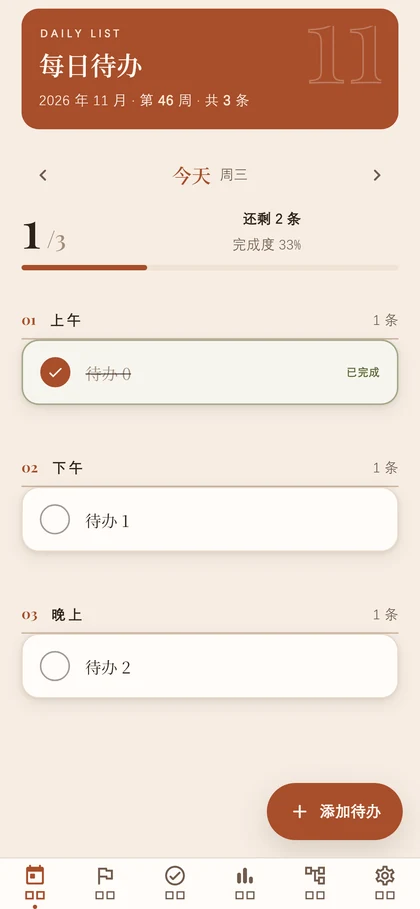
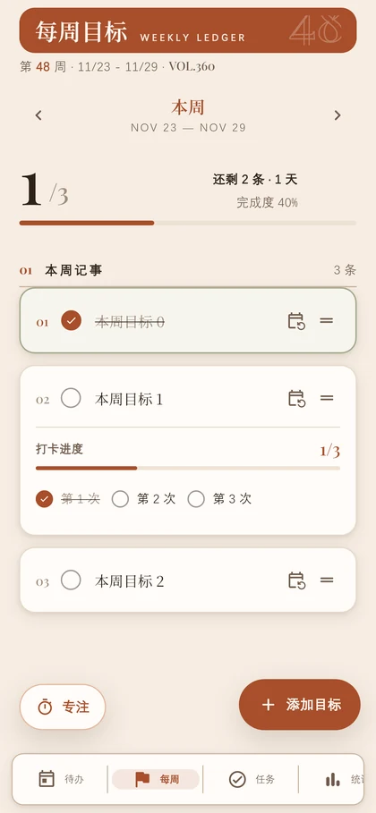
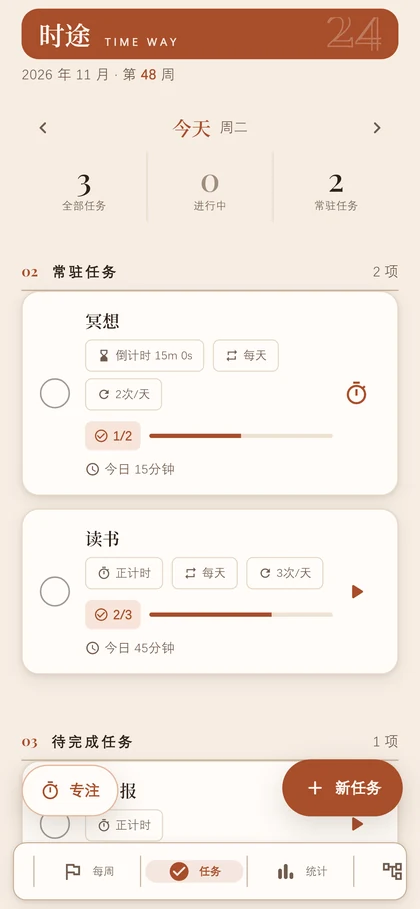
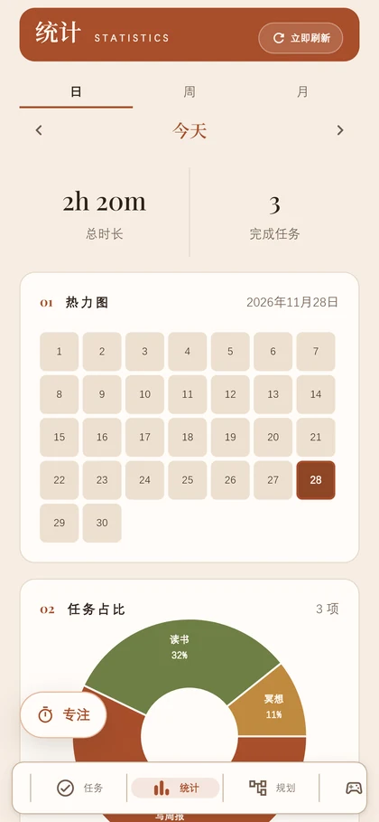
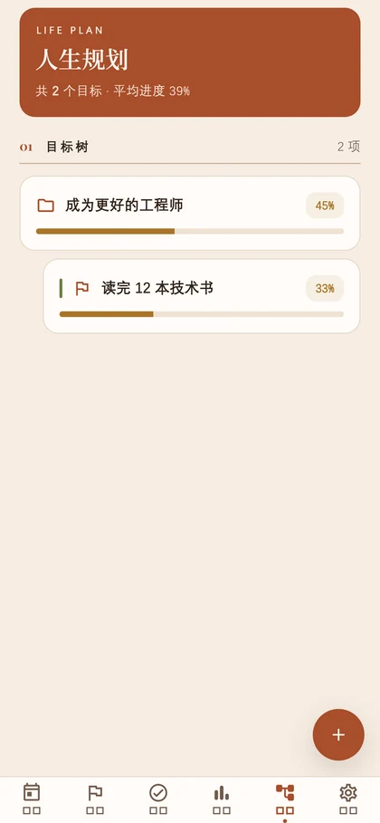
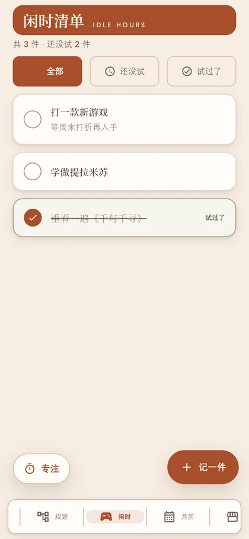
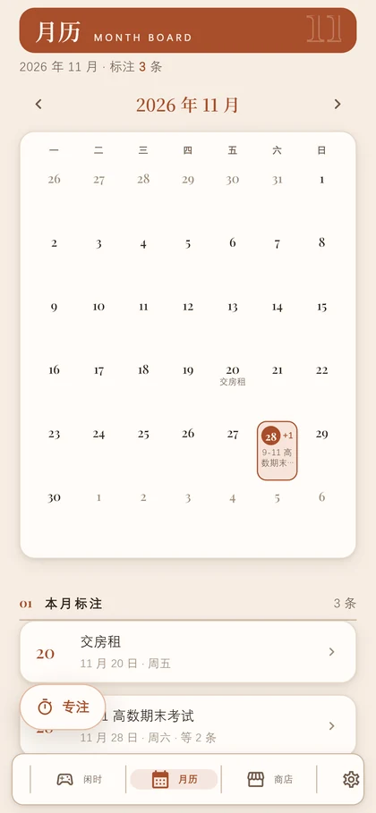
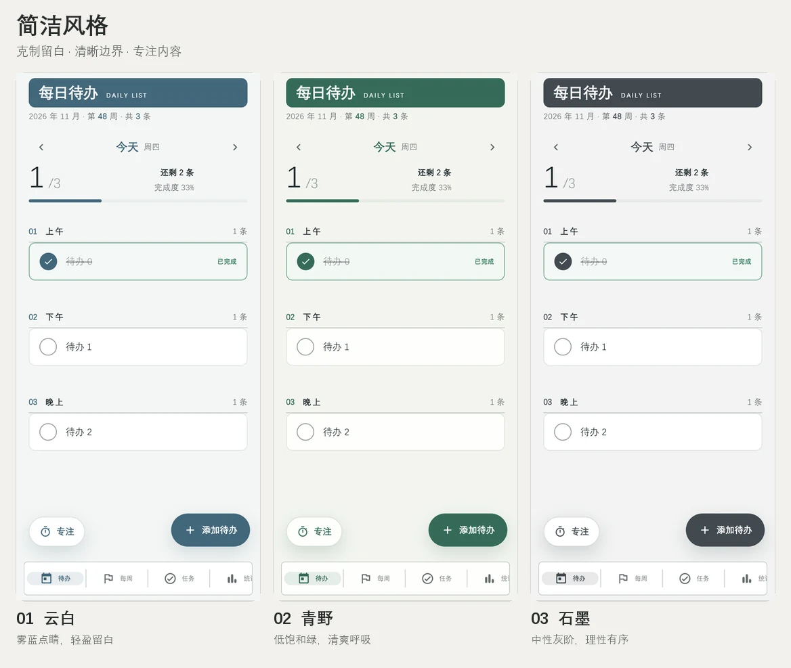
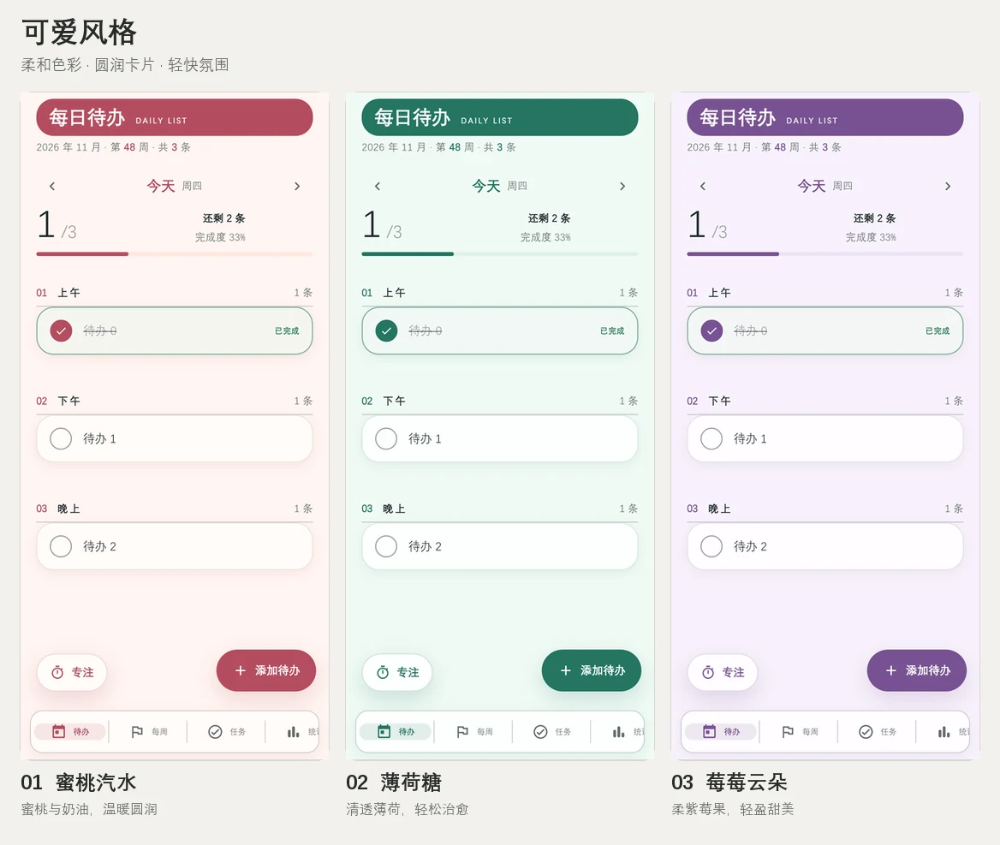
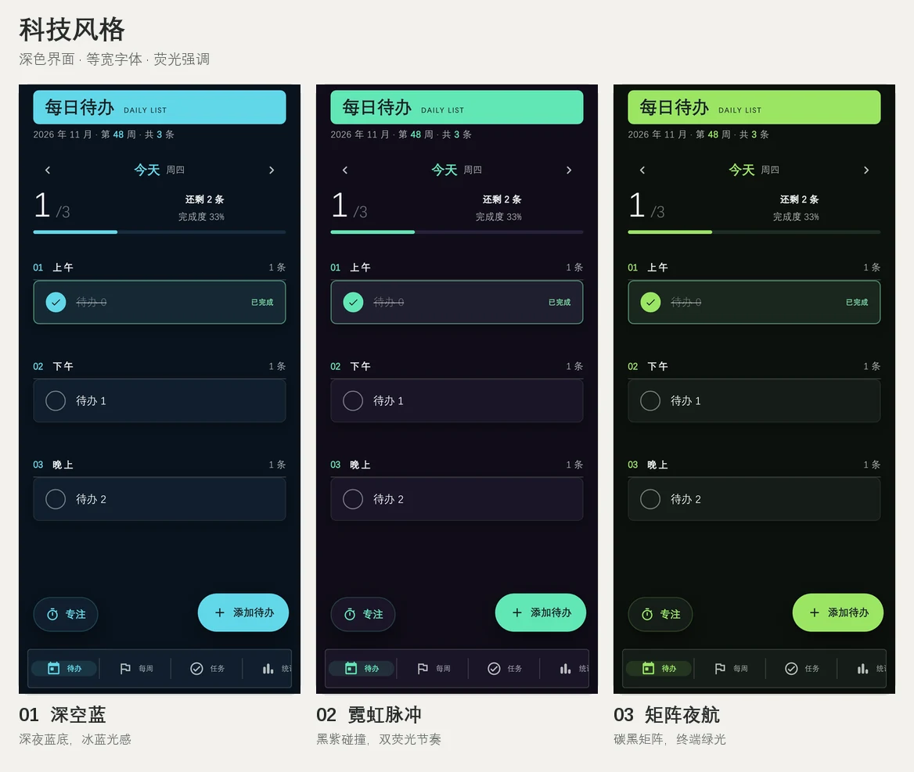

<div align="center">


# 时途 TimeWayPro

**时间规划与人生规划助手**

给任务计时 · 记录真实用时 · 看清时间去向

[](https://flutter.dev)
[](https://dart.dev)
[](#环境要求)
[](#版本迭代)
[](https://github.com/yanxu5656/TimeWayPro/releases)

<p>
  
  
  
  
</p>
<p>
  
  
  
</p>

</div>

---

## 简介

TimeWayPro（中文名「时途」）是一款基于 Flutter 开发的时间管理应用。

它的核心逻辑很简单：**给任务计时 → 把每一段实际用时记录下来 → 用统计图表告诉你时间究竟花在了哪里**。在此之上，再挂载「人生规划」的目标树、「每周目标」与「每日待办」的轻量清单，兼顾长期方向、每周节奏与当天执行；「闲时清单」收着那些不急但想做的事，「月历」则把考试、抢票这类有日子的约定标在整月视图上。

与常见的待办清单不同，时途不满足于「打勾」，而是记录**每件事真实消耗了多少时间** —— 这些记录会沉淀为热力图、饼图和任务明细，让「我很忙」变成「我忙在了这件事上，一共 3 小时 20 分」。

界面默认保留 **陶土暖笺**，同时提供简洁、可爱、科技三组共 10 套可切换主题；颜色、字体、圆角、阴影与深色状态栏会一起变化。方案预览与设计取舍写在下面的[外观主题](#外观主题)一节。

---

## 安装

到 [**Releases**](https://github.com/yanxu5656/TimeWayPro/releases) 下载最新版本的 APK（文件名带版本号，形如 `app-release-1.4.0.apk`），直接装到手机上即可。

**环境要求**：Android 7.0（API 24）及以上。

> ⚠️ 目前的安装包用的是 Flutter 默认的**调试签名**。自己侧载完全没问题，但**不能上架应用商店**；而且如果之后换了签名，覆盖安装会失败（需要先卸载旧版）。
>
> 想自己构建见下面的[快速开始](#快速开始)。

---

## 功能特性

### ⏱ 任务 · 计时

应用的核心模块。

- **两种计时模式** —— 正计时记录实际耗时；倒计时到点自动完成任务
- **多任务并行计时** —— 多个任务可同时处于计时状态，互不干扰
- **后台计时与状态恢复** —— 计时状态持久化，杀掉 App 后重启自动恢复并继续；超过 24 小时的异常计时自动归档
- **暂停 / 继续** —— 中途暂停，恢复后继续累计
- **重复任务** —— 不重复 / 每天 / 每周 / 每月，可设每日重复次数，跨天自动重置完成次数
- **截止日期与提前提醒**：按截止日当天 09:00 减去所选提前量调度通知，使用系统允许空闲时触发的非精确闹钟，无需精确闹钟权限
- **计时记录** —— 每次计时生成一条独立记录（开始 / 结束 / 时长），作为统计模块的数据源

### 📊 统计

- **日 / 周 / 月**三个维度切换，支持前后翻页与直接选日期查看历史
- **概览** —— 区间总时长、完成任务数（切日期时数字滚动）
- **热力图** —— 按月着色，日模式下展示整月网格并高亮当前选中日
- **任务占比饼图** —— 各任务耗时占比，切片标签按底色亮度自动择色
- **任务明细** —— 按耗时排序的列表与占比进度条

### 🎯 人生规划

- **任意层级的目标树** —— 目标可无限层级向下拆分（大目标 → 阶段 → 具体事项）
- **进度管理** —— 每个节点独立调整进度（0% ~ 100%），进度条按区间着色
- **树状图展示** —— 层级以缩进 + 色条呈现
- **级联删除** —— 删除父目标时递归清理所有子目标

### 📝 每日待办

- **独立于任务模块的轻量清单** —— 按日期存储，适合当天临时事项
- **时间段分类** —— 上午 / 下午 / 晚上三段分组，添加时自动定位当前时段
- **完成进度** —— 点击圆圈勾选，顶部进度条实时显示今日完成度
- **滑动删除**（带二次确认）与**长按编辑**

### 🏁 每周目标

- **独立的「每周」Tab** —— 与每日待办平行的周视角，待办页回归纯「当天」
- **任意周访问** —— 左右箭头翻周、直接选日期跳周，翻走后一键「回到本周」；旧周数据完整可回看
- **提前规划下周** —— 翻到任意周后添加，目标就落在那一周
- **快捷挪周** —— 每条目标行尾的挪动按钮打开快捷面板：上周 / 本周 / 下周 / 下下周（各带日期区间）一键挪，更远的周走日期选择器；挪动排在目标周队尾，不动它原有的顺序
- **拖拽排序** —— 按住每条行尾的把手上下拖动即可改顺序，顺序立即落盘；点击编辑与左滑删除不受影响
- **勾选进度** —— 逐条勾选，概览进度条实时显示完成度，满额变绿
- **可选分段完成** —— 开启后可选择「按阶段」生成阶段 1 / 2 / 3，或「按次数」生成第 1 次 / 2 次 / 3 次（1–30 个）；每个打卡点单独勾选，全部完成自动完成整目标，取消任一点会重新打开；顶部周完成度按打卡点加权

### 🎮 闲时清单

- **收着「不急但想做」的事** —— 打一款新游戏、学做提拉米苏、重看一部老电影，与任务/待办互不干扰
- **还没试 / 试过了** —— 勾选即归入「试过了」沉底，芯片筛选全部 / 还没试 / 试过了
- **可选备注** —— 每条可附一句备注（如「等周末打折再入手」），编辑时可清空
- **滑动删除**（带二次确认）与点击编辑

### 📅 月历标注

- **整月日历视图** —— 周一开头的月网格，今天陶土描边高亮，左右翻月、一键「回今天」，跨年无缝
- **自由文本标注** —— 点任意一天写一句：「9-11 高数期末考试」「抢回家的车票」，不做结构化时间字段，怎么记都行
- **格内预览** —— 有标注的日期直接在格子里显示首条内容（两行），多条时日期旁挂「+n」余量计数
- **本月标注议程** —— 日历下方按日期分组列出当月全部标注，点任意一条直达当天面板
- **当天面板** —— 逐条编辑 / 删除，添加后面板不关，可连续记多条

### ☁️ 数据同步与备份

- **坚果云 WebDAV 同步** —— 一键备份 / 恢复，配置步骤见[下文](#坚果云同步配置)
- **本地导入导出** —— 导出为 JSON 文件、从 JSON 文件导入
- **自动备份与原子写入** —— 写入走临时文件 + 改名替换，中断也不会写出半截 JSON；正式文件异常时自动从 `.bak` 回滚

### 🎨 外观主题

- **10 套完整主题**：默认「陶土暖笺」，另有简洁、可爱、科技各 3 款；设置页顶部分组展示迷你预览、名称与一句话风格说明
- **实时全局切换**：点击方案立即应用到八个页面、卡片、导航、弹窗、表单、按钮、图表与系统状态栏，不重置当前 Tab 或专注计时
- **自动保存与恢复**：主题 ID 持久化到本地，重启恢复；历史数据损坏或 ID 未知时安全回退默认主题
- **不只是换色**：各主题同步调整字体、圆角、阴影、刊头水印与明暗模式；科技三款为深色界面
- **可读性守护**：每套主题都经过正文、主色、按钮文字与弱化文字对比度测试

### 🔔 通知栏常驻通知

- 计时进行中在通知栏常驻显示任务名称与计时，每 5 秒更新
- App 被杀死后重启，通知自动恢复

---

## 版本迭代

### v1.10.4 — 十套外观主题与实时换肤
*2026-11-26*

- **新增方案选择器**：设置页最前面加入「外观主题」，按经典文雅 / 简洁 / 可爱 / 科技分组；每张卡片带独立迷你预览，点击即应用并自动保存
- **九款新主题**：简洁提供「云白 / 青野 / 石墨」，可爱提供「蜜桃汽水 / 薄荷糖 / 莓莓云朵」，科技提供「深空蓝 / 霓虹脉冲 / 矩阵夜航」；原「陶土暖笺」继续作为默认主题
- **全局设计令牌**：以 `ThemeExtension<AppDesign>` 统一承载色板、字体、圆角、阴影与刊头策略；页面、卡片、导航、弹窗、表单和图表均改为读取当前主题
- **运行时装配**：`ThemeData` 的 ColorScheme、输入框、按钮、对话框、进度条、开关等组件随主题重建；科技主题同步切换深色亮度与状态栏图标，不通过重建 `MaterialApp` 根节点重置导航和计时状态
- **可靠持久化**：启动异步恢复所选主题，写盘失败保留当前会话选择；损坏值、未知 ID 与加载竞态均有防护
- **方案实机对照**：新增九款主题截图和三组 WebP 联系表；新增 33 个目录、对比度、偏好和实时切换测试，默认套件 275 → **308**，`flutter analyze` 无告警

### v1.10.3 — 每周目标分段打卡
*2026-11-25*

- **普通 / 进度双模式**：创建或编辑每周目标时可开启「分段完成」，普通目标保持原有勾选方式
- **两种生成方式**：按阶段生成「阶段 1 / 2 / 3」，按次数生成「第 1 次 / 第 2 次 / 第 3 次」；数量限制 1–30，修改数量保留对应序号的状态，切换类型重新开始
- **逐点记录与自动完成**：行内展示进度条、完成数和独立打卡点；全部完成自动完成目标，取消任一点重新打开；整目标勾选会同步所有打卡点
- **加权周完成度**：普通目标计 1 个单位，分段目标按打卡点数量计单位，避免一个 10 次目标与一次普通任务等权
- **向后兼容与可靠写入**：打卡点内嵌保存，旧备份无需迁移；逐点勾选乐观更新、失败回滚且不触发列表 loading；新增 15 个测试，默认套件 260 → **275**，`flutter analyze` 无告警

### v1.10.2 — 单行横滑导航与安静触感
*2026-11-24*

- **底部导航改为单行横向滚动**：八个入口固定为略宽于原四格的按钮，保留图标与文字，竖向分隔线明确划分每个入口；选中项使用陶土浅底，切换后自动滚入可见区域
- **导航点击不再振动**：关闭导航项的 `HapticFeedback.vibrate` 与 `selectionClick`，保留按压缩放和选中过渡，不改变页面内按钮的既有触感
- **释放首屏空间**：导航实测高度同步收紧，各页底部留白 `navInset` 从 140 调到 96，320dp 窄屏仍可完整横滑
- 新增横向布局、窄屏项宽、无振动与自动滚动回归测试，默认套件 258 → **260**，`flutter analyze` 无告警

### v1.10.1 — 数据一致性与提醒可靠性审查
*2026-11-24*

**数据安全**

- **写入事务化**：内存修改与落盘进入同一条串行队列，写盘失败自动恢复执行前快照，不再出现「界面显示成功、重启却没有」的幽灵数据；任务与计时记录改由一次事务级联删除，避免孤儿记录
- **恢复顺序修正**：云恢复与本地导入都先完成下载、解析和格式校验，再停止正在运行的计时，随后替换数据并刷新全部模块；下载或校验失败不会误停计时
- **导入更严格**：缺失核心表、表类型错误或行形状错误会被拒绝；正式文件表结构损坏时自动回退到 `.bak`；导入进度限制在 0–100%，非法枚举与坏行有安全回退
- **可空字段真正可清空**：任务描述、倒计时时长、截止日、提醒、完成日期、规划描述与父级、闲时备注等 `copyWith(null)` 现在会清空原值；每日重复任务跨天重置不再残留上次完成日期

**功能与交互**

- **截止提醒补齐调度**：设置「截止日期 + 提前提醒」后会实际创建本地通知，任务完成、编辑、删除或数据恢复时同步更新；提醒时间统一为截止日 09:00 减去提前量，过期提醒不补发
- **表单保存可恢复**：新建、编辑、删除与排序增加保存中状态和失败反馈，失败保留页面与用户输入；乐观删除和拖拽排序失败会回滚，勾选等操作失败会明确提示
- **快速切换不串页**：日、周、月异步加载增加代际保护，旧请求后完成也不会覆盖新页面；读取失败保留已有内容，不再伪装成空数据
- **专注响铃 deadline 修正**：45/5 闹铃进入响铃阶段后清除已过期的计时截止时间，避免后续逻辑继续引用过期节点

**工程**

- 日期选择上限改为随当前年份动态计算，修复 0 秒倒计时、纯空白标题与过去日期导致选择器越界等问题
- 新增 22 个回归测试，覆盖写盘故障回滚、级联删除、数据校验、可空字段、提醒时间与残留通知清理、规划坏行、乱序加载与循环子树；默认套件 236 → **258**，`flutter analyze` 无告警

### v1.10.0 — 刊头瘦身、两行导航与「闲时 / 月历」两个新模块
*2026-11-17*

**布局：把空间还给内容**

- **刊头瘦身**：八页统一从「眉题 + 大标题 + 水印 + meta + 铅线」的多行色带（约 124dp）收为单行色带（约 76dp）——眉题与标题同行基线对齐、描边水印从 104px 缩到 56px，meta 信息移到色带下方的纸面脚注，首屏有效内容区明显变大
- **底部导航改两行 4×2**：八个入口（待办 / 每周 / 任务 / 统计 / 规划 / 闲时 / 月历 / 设置）两行排布，行间发丝线分隔；导航高度实测自适应，各页滚动留白（`navInset`）随之从 120 调到 140，320dp 窄屏不溢出

**新增：闲时清单**

- 独立模块记录「不急但想做」的事：标题 + 可选备注，勾选后归入「试过了」沉底；全部 / 还没试 / 试过了三档筛选，滑动删除带二次确认，删除走乐观更新不闪回

**新增：月历标注**

- 整月日历（周一开头）+ 自由文本日标注：点某天写「9-11 高数期末考试」「抢回家的车票」这类一句话约定；格内两行预览 + 「+n」余量计数，今天陶土描边；翻月 / 回今天 / 跨年，下方「本月标注」按日分组议程直达当天面板；面板内连续添加、逐条编辑与删除

**工程**

- 数据层新增 `leisure_items` / `calendar_notes` 两张表，旧备份导入自动补表，零迁移
- 新增 26 个测试（两模块仓储 + 界面全流程），默认套件 210 → 236；README 截图管线扩到 7 个 Tab + 日标注面板

### v1.9.0 — 全按钮交互升级：按压、触感与状态形变
*2026-11-17*

- **统一按压语言**：`PressableScale` 下沉式按压——110ms easeOut 按下、220ms easeOutBack 回弹，主按钮与 FAB 附加 1.5px 下沉与阴影压缩（FAB 影随按压从 24px 收到 6px），按钮 / 芯片 / 勾选圈 / 刷新按钮全 app 同一手感；系统「减弱动效」开启时自动只留触感、不做缩放。
- **触感词汇 `AppHaptics`**：轻点与选择 `selectionClick`、完成 `mediumImpact`、删除等破坏性确认 `heavyImpact`、停铃 `mediumImpact`——按语义分级，不再一律重震。
- **`PaperButton` 家族**：包装真实 Material 按钮（语义与无障碍不变），标签 / 图标 180ms `AnimatedSwitcher` 形变（开始↔暂停、创建↔保存、刷新↔刷新中）；专注开始与同步保存带 loading 态——spinner 替换图标、文案切换、期间禁用防连点。
- **完成时刻**：`InkCheckCircle` 仅在「未勾→勾选」瞬间打勾 easeOutBack 弹出 + 陶土涟漪环 320ms 扩散 + 一次 mediumImpact；恢复已勾选数据与取消勾选均不播动画。
- **分段与芯片**：`SegmentedControl` 指示线 260ms easeOutCubic 滑动到选中段并伴随选择触感；`PaperChip` 220ms 填充形变 + 图标 easeOutBack 轻弹。
- **暖色涟漪**：三套按钮主题统一 `overlayColor`——陶土底上暖白波纹、纸底上陶土波纹，替换默认灰波纹；弹窗 / 表单 / 横幅 / 设置页全部迁移到 Paper 家族，触控目标保持 ≥44dp。

### v1.8.0 — 专注闹铃后台准时响铃 + 仅振动模式
*2026-11-16*

- **修复后台不响铃**：专注计时改由原生前台服务全程保活——计时期间通知栏常驻系统渲染的倒计时，锁屏、切后台、最近任务清理后进程依然存活，到点直接响铃；同时预约系统 `AlarmManager` 闹钟作为唤醒备份，开机后自动恢复计时。
- **电池优化引导**：首次开始专注时引导加入电池优化白名单，并提示小米 / 华为 / OPPO / vivo 等机型开启自启动，避免国产 ROM 后台查杀。
- **闹铃模式可选**：专注计时页新增「响铃 + 振动 / 仅振动」切换，仅振动模式适合会议、课堂等安静场合；模式持久化保存，响铃中切换立即生效。
- **闹铃保护**：无人关闭时最长响 10 分钟自动停止。

### v1.7.3 — 全局悬浮 45/5 专注计时与持续振动闹铃
*2026-11-14*

- **全局可拖动悬浮入口**：在「待办 / 每周 / 任务 / 统计 / 规划 / 设置」六个页面表层统一展示「专注」悬浮胶囊按钮（支持拖拽调整位置），任意页面一键进入专心计时页。
- **45 分钟专注 / 5 分钟休息循环**：基于壁钟截止时间与本地持久化计算剩余倒计时，切后台或恢复前台自动校准时间节点并推送通知栏倒计时。
- **持续振动闹铃强提醒**：原生集成 Android `Vibrator` 循环波形振动 + `USAGE_ALARM` 循环闹铃 + `FLAG_INSISTENT` 高优先级通知，在专注满 45 分钟或休息满 5 分钟时持续提醒，支持在计时页、通知栏或任意页面顶部横幅一键停铃并衔接下一阶段。

### v1.7.2 — 统计页「立即刷新」按钮与恢复防重入
*2026-11-14*

- **统计页「立即刷新」按钮**：在统计页刊头右侧新增「立即刷新」按钮，点击后立即重载任务/计时记录并刷新图表与总时长
- **同步与防重入**：`stopTimer` 更新记录后立即递增 `dataVersion`；`_restoreActiveTimers` 跳过内存中已在运行中的计时器，避免重载任务时重复创建定时器

### v1.7.1 — 任务计时与统计刷新修复
*2026-11-14*

- **一键结束计时**：移除点击停止按钮时弹出的二次确认弹窗，点击一次直接结束计时并记录用时；新增 `_stoppingTimers` 防止连点重入
- **通知栏残留修复**：`NotificationService` 引入代次令牌与串行队列，在 `stopTimer` 开头同步停掉周期更新并严格串行 `show`/`cancel`，消除异步刷新在 `cancel` 后把通知贴回的竞态；完成正在计时的一次性任务及重启恢复后无活跃计时时同步清理通知
- **统计时长即时刷新**：`TaskProvider` 新增 `dataVersion` 版本号，`StatisticsScreen` 与 `TaskScreen` 跟随版本号变化实时刷新（保留计时每秒 tick 不闪烁、通知栏每 5 秒刷新节流）

### v1.7.0 — 陶土暖笺 + 每周拖拽排序
*2026-11-11*

**动机**：静白志的排版骨架是对的，但纸白 + 墨 + 朱砂偏冷、偏「文档」，日常用少了点温度。对比四个方向后选定**陶土暖笺**——保留编辑排版与衬线数字，把材料换成暖纸与陶土，并把分层语言从「发丝线」改回「圆角卡片」。

**配色与表面**

- **暖纸底 `#F6EDE3` + 墨字 `#2E2119` + 陶土 `#A84E2B`**：陶土既是操作色也是强调色（按钮 / 选中态 / 刊头色带 / 进度条），墨只负责文字
- **卡片重新成为主表面**：`PaperCard` 四档——`row`（暖白卡 + 16px 圆角 + 微影，列表行默认）、`ruled`（细线分区）、`raised`（浅陶土底，嵌套块）、`flat`（透明）。同屏只有 `row` 带阴影，避免影子糊成一片
- **刊头改实色陶土色带**：页面内缩的圆角色带，水印数字改暖白描边；页面写死的纸面语义色由 `_RecolorMeta` 统一重映射到色带上的可读色，六页文案不用改
- **圆角放宽**：`xs 3 / sm 6 / md 10 / lg 12 / xl 14 / sheet 16`，新增 `card 16` 与 `full`
- **对比度守住 AA**：`textPrimary` 13.5:1、`textSecondary` 5.5:1、`primary` 4.8:1、色带上文字 5.3:1。两处主动偏离设计稿：`success` 加深到 `#5C6B39`（原稿 3.8:1 不够小字用），色带次要文字用 92% 暖白（原稿 78% 不过 AA）

**每周目标拖拽排序**

- 每条行尾一个显式把手，按住上下拖动改顺序。不用整行长按——整行已经承担点击编辑与左滑删除，三种手势会互相抢
- 整周 `sort_order` 重编号成 `0..n-1`，队尾追加取的 `max+1` 不会与现存值撞车
- `DatabaseHelper.updateAll` 批量写：拖一次只落盘一次，而不是 N 条目标排 N 次全库写盘
- 乐观更新，不走 `loadGoals`——否则拖完的瞬间整张列表会被加载圈替换

**版本号防漂移**：设置页读的是 `AppConstants.appVersion`，它曾停在 1.3.3 而 pubspec 已到 1.6.0。两处同步到 1.7.0，并加 `test/core/constants/app_version_test.dart` 守护二者一致。

### v1.6.0 — 编排精修
*2026-10-31*

**动机**：静白志用下来方向对了，但「素」了些、部分排布不够优雅。对比四个升级方向（暖笺文武线 / 浮笺卡片 / 玄墨对页 / 编排精修）后选定**编排精修**——颜色几乎不动，专治排布：字号对比、元信息收拢、区块编号、间距节奏。

**排版系统（全部六页统一）**

- **刊头水印**：右上角当周 ISO 周号 / 当日日期的巨号描边空心数字（132px Playfair，墨色 13%），被铅线裁切——素纸面有了体量锚点
- **元信息行**：原先散落的 期号 / 年月 / 周号 / 计数 收拢成标题下一行间隔号分节的 meta（`第 44 周 · 10/19 - 10/25 · VOL.359`），关键数字朱砂
- **编号区块**：每个内容区块一个衬线朱砂序号 + 拉字距小标 + 右对齐计数（`01 · 本周记事 · 3 条`），下缘重规线与发丝行线形成粗细节奏
- **大分数**：每周 64px、待办 48px、任务统计条 30px，右侧配「还剩 X 条 · 距周末 X 天 / 完成度 Z%」两行小注
- **周行日期改英文大写**（`OCT 19 — OCT 25`），与眉题同一套编辑语言；`week.dart` 新增 `isoWeekNumber`（周四定年定周，跨年 53 周有测试）
- **间距放宽**：账本行 14 → 17px，区块间距统一

**各页落点**：每周（水印 44 + 全套）；待办（水印日期 + 上午/下午/晚上 编号化）；任务（水印 + meta 带计时中计数 + 统计数字放大 + 三区块编号）；统计（热力图/占比/明细 编号化，右侧带计数）；规划（meta 带总数与平均进度 + 目标树区块头）；设置（三组编号化，右侧带连接状态与版本号）；挪周弹窗改编号账本行。

**边界**：纯排版层——不动组件 API、不动配色、不动交互与数据层。

### v1.5.1 — 收尾：图标、健壮性与安全修复
*2026-10-24*

**应用图标**——重做为静白志风：纸白平涂底 + 墨色不闭合圆环 + 缺口端点的朱砂圆点（当下），与 app 内的墨圈朱砂勾选是同一套语言。`tool/make_app_icon.py` 改参数重跑即得全套平台资源。

**健壮性**（全面代码核查的产出，按严重度）：

- **写盘串行化**：`DatabaseHelper` 加写队列——原先两条写链交错时会争用同一个 `.tmp` 文件（测试日志里的 errno 32 就是它），坏的序列甚至让正式文件处于缺失状态。同时落盘失败不再被吞掉，「恢复成功」的提示不会再与磁盘实际状态不符
- **多计时器通知错乱**：停掉并行计时之一后，通知栏会被已停止任务的旧更新器刷回去且永不恢复——现在停止/恢复计时都会重绑通知的周期更新器
- **停止计时的记录污染**：找不到本次会话的记录时（如计时中做了数据恢复），原先会回退改写该任务**最旧**的一条历史记录——现在放弃更新而不是污染
- **恢复/导入的完整刷新**：原先只重载任务/规划两个 provider，待办与每周页在 IndexedStack 保活下继续显示旧数据、幽灵操作静默失败——现在先停掉所有计时器再四个 provider 全量重载
- **导入竞态**：冷启动后立即导入可能被在途的磁盘读取整体覆盖回去——`importAll` 先等初始化落地
- **双击开始计时**：异步空窗会插入两条记录并泄漏一个每秒 tick 的孤儿 Timer——加同步占位防抖
- **日期运算 DST 修正**：周/日导航改构造函数日运算，夏令时区不再跳周/跳日
- **统计区间改半开**：闭区间 `23:59:59` 会漏掉最后一秒内开始的记录
- **行级容错**：单条脏数据（旧备份缺字段）不再让整页列表静默消失

**安全**：`exportAll` 不再随数据导出坚果云**应用密码**（原先备份文件与导出文件里是明文）。恢复旧备份后需要在设置里重新输入密码。

**一致性**：九个底部弹窗标题统一为衬线（原先 16/18/20px 三种并存）；同步状态卡改浮起白卡（raised 档）；分段控件未选中色从 textHint 修正为 textSecondary（对比度硬规则）；每周页期号对锚点前的周做了防御。

**已知留白**（低风险，暂不处理）：多计时器时每秒多次 `notifyListeners` 的整页重建开销；计时中编辑倒计时时长已即时生效，但通知总时长取值路径仍有缓存；明文凭据仍存本地 JSON（仅不再外流）。

### v1.5.0 — 静白志（全面 UI 迭代）
*2026-10-24*

**动机**：极光玻璃用了几个版本后觉得「不够大气」。对比了四个方向（曜石金 / 静白志 / 极光 2.0 / 云墨）后选定**静白志**——纸白编辑排版风，高级感来自排版与克制，不靠特效。

**视觉语言**

- **三种材料**：纸（`#FAF7F1` 底）、墨（`#1D1A14` 文字与操作色）、朱砂（`#C5402C`，全应用唯一强调色）
- **衬线字体打包**：Playfair（数字主角：1/3、时长、统计大数字）+ 思源宋子集（刊头、账本行），`tool/subset_fonts.py` 生成，合计约 3.3MB
- **刊头制**：每页顶部是眉题（DAILY LIST / WEEKLY LEDGER…）+ 衬线大标题 + 铅线，标题属于内容而非 chrome
- **账本行**：列表一律细线分隔的行（row 档只有下缘发丝线，强调态左缘 2.5px 着重线），卡片退位
- **大分数**：完成度用 40px+ 衬线数字呈现，数字是页面的主角
- **性能红利**：`BackdropFilter`、渐变描边、极光层全部移除——「按帧耗降档」防的两项重负载不复存在，中低端机直接受益

**工程**

- 组件层整体改名：`Glass*` → `Paper*`（`glass.dart` → `paper.dart` barrel），表面档位 flat / row / ruled / raised
- 令牌层换血但**骨架不动**：全部令牌名保持，页面零改名成本；统计页图表只换了三个色板常量
- 对比度护栏更新为纸面体系（墨 16.1:1 AAA / 次级 5.3:1 AA / 提示仅装饰 / 朱砂 4.8:1），`tokens_test` 直接算 WCAG 对比度断言
- golden 探针重写为 `paper_gallery`（衬线混排 / 细线 / 色板）；截图管线把等线注册为 Roboto 家族，修掉了自 1.3.0 起 README 截图里底部导航文字一直是方块的旧问题
- 字体管线：可变字体下载 → 按字重实例化 → GB2312 一级 + 应用文案子集化，一条脚本可重跑

**边界**

- 布局结构、交互、数据层零改动——纯表现层替换（沿用 1.3.0 的纪律）
- 仅浅色主题，不做深色模式
- `UiEffects` 降档体系保留，现在只管错峰入场与数字滚动

### v1.4.0 — 每周目标独立成「每周」Tab
*2026-10-24*

**动机**：实际使用中的两个痛点——周目标卡**挤占待办页顶部的固定头部**；**只能看本周**，既回看不到以往周的计划，也没法提前列下周的。

**新增**

- **「每周」Tab**（待办右侧）：周导航（左右翻周 / 选日期跳周 / 回到本周）+ 概览进度 + 目标列表，结构与待办页的日期导航一致
- **任意周访问**：翻到哪周就看哪周，旧周数据（v1.2 时代存在 JSON 里的）直接可回看，零迁移
- **提前规划**：翻到下周再点添加，目标就建在下周；添加弹窗会标注「将添加到：下周（日期区间）」
- **快捷挪周**：目标行尾按钮 → 面板列出 上周 / 本周 / 下周 / 下下周（各带日期区间，所在周标「当前」不可点）+「选其他周…」走日期选择器。挪动 = 改 `weekKey` 并排到目标周队尾

**改动**

- 待办页摘除周目标卡，回归纯「当天」视角
- 底部导航 5 → 6 个 Tab；滑动指示块宽度从固定 56 改为按单项宽度自适应（320dp 屏 6 项时单项约 53dp，固定宽会溢出到相邻项）
- `WeeklyGoal` 模型与仓储从 `features/daily/` 移入新模块 `features/weekly/`，新增带周导航状态的 `WeeklyProvider`；**数据格式零变更**
- `week.dart` 新增 `weekRangeLabel()`（周区间的显示文本，与 `weekKeyOf` 同样手工拼接不依赖 intl）

**实现说明**

- 「本周」标签与 `isCurrentWeek` 都对 `DateTime.now()` 现算——应用开着跨过周日午夜，浏览中的周会自动变成「上周」，不会显示错
- 删除目标改为**乐观更新**（先同步移出本地状态再持久化）：滑动删除的动画播完才触发 `onDismissed`，时序上晚于用户手势，等持久化返回再刷新会看到「删了又闪回来」的一瞬
- 挪周的快捷档固定相对「真实本周」（上周/本周/下周/下下周）而不是相对浏览中的周——相对浏览周会让「本周」这个词在不同页面位置含义漂移，绝对标签 + 日期区间不会歧义

### v1.3.3 — 写入可靠性与任务页日期
*2026-09-18*

**修复**

- **保存不再是「先覆盖再说」**。原先每写一次都是「把正式文件整个复制成 `.bak`，再直接覆盖正式文件」——写到一半被杀进程，正式文件就是**半截 JSON**，下次启动只能回滚到上一次，刚做的改动丢掉。现在改为：写临时文件（`flush` 落盘）→ 旧的正式文件改名成 `.bak` → 临时文件改名顶替。两次 `rename` 都只改元数据，调用方要么看到旧的、要么看到新的，**不存在中间态**。顺带不再有每次写入都整文件复制的开销。
- **正式文件缺失时不再静默当作「没有数据」**。原先只在**读取抛异常**时回退到 `.bak`；文件**不存在**时会以空表启动——对全部价值就是这份数据的应用来说，这是个静默的数据丢失路径。现在文件缺失也会先试备份。
- **任务页的日期选择器接上了真实数据**。原先它只改标题：卡片上那个「今日 X分钟」的数据源把「今天」写死在方法体里，翻到上周三，标题变了、数字还是今天的。现在翻到哪天就聚合哪天的记录，今天显示「今日」、其它日期显示「当日」。
- 卡上那个时长文字从 `textHint` 换到 `textSecondary`：12px 且承载真实数据，前者在玻璃底上只有约 3.1:1 对比度，低于 [对比度规则](#纸面的对比度约束)要求的门槛。

**边界**

- 任务**列表内容不随日期变化**：任何日期都列出完整列表，日期只影响那个时长数字。这是刻意的——若按日期过滤，今天会看不到尚未开始的任务，也就无法开始它们。
- 记录的日期归属只看 `start_time`，所以跨午夜的计时整段算在开始那天。

**说明**

- v1.3.3 时「原子性」这条属性**没有单元测试**；v1.10.1 起通过文件系统故障注入覆盖写盘失败回滚、队列后续写入与加载回退。进程在写入中途被杀仍靠代码结构保证：正式文件只经 `rename` 替换，从不被就地覆写。

### v1.3.2 — 修复添加待办弹窗
*2026-09-18*

**修复**

- 「添加待办」弹窗里的**时间段选择被一块灰色方块挡住，且待办创建不了**。

  根因是 `GlassChip` 把 `Expanded` 包在了 `GestureDetector` 里面。`Expanded` 是 `ParentDataWidget`，**必须是 Flex 的直接子节点**；隔着一个 RenderObjectWidget 会让父数据挂到错误的 RenderObject 上。这个误用在 debug 下单抛异常，在 **release 构建**里则会把该子树替换成 `ErrorWidget` —— 也就是一块纯灰色方块。随后布局异常又让整帧不可交互，所以「也创建不了」。

- 补上对应的回归测试（打开弹窗、chip 等宽、键盘弹起时的布局、真实创建流程）与弹窗截图。此前**测试与截图都只覆盖 5 个 Tab 页，从未打开过这个弹窗**，所以一直没暴露。
- 测试脚手架补上 `path_provider` mock 与「真实 IO 放行」工具，现在可以覆盖新建 / 编辑 / 删除这类写入流程了（此前任何写入都会在 FakeAsync 里挂死，等于没测过）。

### v1.3.1 — 一致性与本周目标
*2026-09-17*

**新增**

- 待办页新增「本周目标」：可勾选的周目标清单，勾选进度即完成度。只显示本周，旧周数据保留可回溯

**一致性修复**

- **顶栏图标**：5 个 Tab 里只有前两个带图标徽标。而且 `GlassAppBar` 在没传图标时连占位都不渲染，导致后三页的标题整体靠左约 40px —— 不只是少了图标，是标题位置都没对齐
- **圆角按控件角色统一**：chip 竖排的硬编码 14、两个「滑动指示块」一个 9 一个 12、任务卡与统计概览卡用 20 而同类的待办 / 规划卡是 16、完成勾选钮两页尺寸与颜色都不同、规划页有个按钮就地覆盖了主题圆角

**应用图标**

- 设计并生成全套图标：青绿径向渐变底 + 不闭合的圆环，缺口端点的圆点是「当下」
- 补上 **Android 自适应图标** —— 此前完全缺失，Android 8+ 上系统会把那张方图缩小塞进白底形状
- 应用名从包名 `time_way_pro` 改为「时途」

**工程**

- 抽出 `lib/core/utils/week.dart`：「本周周一是哪天」原先在统计页内联重复了 4 处
- `DatabaseHelper` 的表清单原先在文件里重复 6 次（加一张表要同步改 5 个地方），收敛为一处；顺带修掉 `importAll` 不跑兜底、导入旧备份后新表键缺失的问题

### v1.3.0 — 浅色极光玻璃
*2026-09-17*

界面重做，并借此建立了一套设计系统。**功能逻辑完全没动，只改表现层。**

**界面**

- 极光背景层：三个缓慢漂移的光斑（48 秒周期），视觉上是氛围而不是噪音
- 磨砂玻璃：顶栏、底部导航、底部弹窗、FAB 四处用真高斯模糊；滚动列表里的卡片改用「渐变内高光描边 + 半透明填充」的仿玻璃
- 底部导航：滑动指示块 + 图标交叉淡入，取代原先「只有背景色在变 + 图标硬切换」
- 动效：列表错峰入场、按下回弹、统计数字滚动

**设计系统**

- 抽出令牌层（颜色 / 圆角 / 间距 / 阴影 / 文字），收敛原先散落在页面里的 153 处圆角字面量、约 90 处间距、93 处硬写 `TextStyle`
- 抽出玻璃组件层，取代 15 处重复的卡片装饰、7 处底部弹窗、6 处手写顶栏、3 处自绘 chip

**自适应降级**

- 按真实光栅化耗时自动降档：p90 超过 20ms 停极光动画，超过 28ms 再关掉真模糊。只降不升，避免档位抖动
- 系统的「减弱动效」开关也会触发降级

**新增**

- 统计页日期导航：前 / 后一天、周、月切换，可直接选日期
- 热力图「日」模式改为展示整月网格并高亮选中日

**修复**

- 饼图切片标签原先是硬编码白色，在浅黄 / 浅蓝这类切片上完全读不出，改为按底色亮度择色
- 热力图色阶从 10 档压到 5 档，并修掉一处会越界崩溃的下标取值

**清理**

- 删除死代码 `timer_screen.dart`（306 行，且是重复的第二套计时实现）
- 移除零引用依赖 `go_router` / `crypto`

### v1.2.0 — 每日待办
*2026-08-02*

- 每日待办：独立界面，与任务 / 统计 / 规划模块无关
- 时间段分类（上午 / 下午 / 晚上）、点击勾选完成、今日进度
- 滑动删除、长按编辑
- 通知栏常驻通知与 Android 13+ 通知权限申请

### v1.1.0 — 通知栏常驻通知
*2026-08-02*

**新增**：计时中在通知栏常驻显示；每 5 秒更新；杀掉 App 后重启自动恢复

**修复**：每日完成次数自动重置、后台计时准确性、杀掉 App 后计时状态恢复、统计页面频繁刷新、坚果云同步稳定性、并发数据安全性

### v1.0.0 — 初始版本
*2026-08-01*

任务管理（正 / 倒计时、重复规则）、统计面板（热力图 / 扇形图 / 明细）、人生规划（层级拆分与树状展示）、坚果云 WebDAV 同步、后台计时、每日重置

---

## 设计系统

1.3.0 把散落的样式收敛成令牌 + 组件，1.5.0 在同一套骨架上把视觉语言整体换血为「静白志」（纸、墨、朱砂），1.7.0 再换成「陶土暖笺」——暖纸、墨、陶土三种材料，层次靠**圆角卡片与排版**表达，不再有模糊与渐变。1.10.4 起，这套令牌升级为运行时主题，可一键切换十套完整外观。

### 令牌

| 类别 | 位置 | 说明 |
| --- | --- | --- |
| 主题目录 | `lib/core/theme/app_design.dart` | 10 套主题的稳定 ID、色板、字体、形状、阴影与风格元数据 |
| 运行时主题 | `lib/core/theme/app_theme.dart` | 由 `AppDesign` 装配 Material 3 的 ColorScheme、组件与文字主题 |
| 颜色 | `lib/core/theme/app_colors.dart` | 默认暖纸 `#F6EDE3` / 墨 `#2E2119` / 陶土 `#A84E2B` + 暖色系图表色板 |
| 圆角 | `lib/core/theme/app_radius.dart` | `xs 3` / `sm 6` / `md 10` / `lg 12` / `xl 14` / `sheet 16` + `card 16` / `full` |
| 间距 | `lib/core/theme/app_spacing.dart` | 4pt 网格 + 语义常量（`screenH` / `cardPad` / `navInset`） |
| 阴影 | `lib/core/theme/app_shadows.dart` | 默认主题只有 `e1`（账本行卡）/ `e2`（弹窗、FAB）两档微影 |
| 文字 | `lib/core/theme/app_text.dart` | 15 档 M3 槽位 + 衬线组（`masthead` / `titleSerif` / `bodySerif` / `serifNum` / `kicker`）+ 补充组 |
| 偏好持久化 | `lib/features/settings/providers/theme_provider.dart` | 通过 `selected_theme_id` 保存与恢复所选主题 |

页面通过 `context.colors`、`context.text`、`context.shape` 读取当前 `ThemeExtension<AppDesign>`；未挂载扩展时回退到默认暖笺，原有 `AppColors` / `AppText` / `AppRadius` 仍作为默认设计基准。主题切换更新 `MaterialApp.theme`，不替换应用根节点，因此当前 Tab、滚动位置和计时状态不会重置。

### 外观主题（v1.10.4）

设置页顶部即可选择，点击后实时应用并自动保存。每套方案都使用真实应用页面截图，而不是单独绘制的色卡。

| 风格 | 方案 | 视觉取舍 |
| --- | --- | --- |
| 经典文雅 | **陶土暖笺**（默认） | 暖纸、陶土、衬线数字、16dp 圆角与双层行阴影 |
| 简洁 | **云白** | 雾蓝 + 大面积留白，无行阴影，信息边界更克制 |
| 简洁 | **青野** | 低饱和森林绿，清爽自然的轻量清单感 |
| 简洁 | **石墨** | 中性灰阶，去掉装饰，专注内容本身 |
| 可爱 | **蜜桃汽水** | 蜜桃红 + 奶油白，22dp 大圆角与柔和投影 |
| 可爱 | **薄荷糖** | 清透薄荷绿，轻快而不刺眼 |
| 可爱 | **莓莓云朵** | 柔紫与莓果色，轻盈甜美的圆润卡片 |
| 科技 | **深空蓝** | 深夜蓝 + 冰蓝，8dp 圆角与较长阴影 |
| 科技 | **霓虹脉冲** | 黑紫底 + 荧光绿 / 紫双强调色 |
| 科技 | **矩阵夜航** | 碳黑 + 终端荧光绿，等宽字体强化仪表感 |

#### 简洁：3 款方案



#### 可爱：3 款方案



#### 科技：3 款方案



单款高清预览位于 [`docs/themes/`](docs/themes/)，命名与主题 ID 一致，例如 `cute_peach.webp`。重新生成：

```bash
flutter test test/golden/screenshots.golden.dart --update-goldens
python tool/make_theme_previews.py
```

### 衬线字体（打包资产）

编辑风的灵魂是大数字与宋体标题，而 Android 没有可依赖的系统衬线。两套字体由 `tool/subset_fonts.py` 从可变字体实例化 + 子集化后打包（合计约 3.3MB）：

| 家族 | 用途 | 子集范围 |
| --- | --- | --- |
| Playfair（500/700） | 数字主角：1/3、时长、统计大数字 | 拉丁 + 数字（每个仅 50KB） |
| NotoSerifSC 思源宋（400/600） | 刊头、区块标题、账本行正文 | GB2312 一级常用字 + 应用文案 + 标点（每字重约 1.6MB） |

界面出现「口」方块说明用到了子集外的字：把字加进脚本的 `EXTRA_CHARS` 重跑即可。

### 纸面的对比度约束

底色恒为暖纸（亮度约 0.87），对比度比玻璃时代宽裕得多，但仍有一条硬规则由测试守护（`test/core/theme/tokens_test.dart`）：

| 前景色 | 对比度 | 结论 |
| --- | --- | --- |
| 墨 `textPrimary` | ≈ 13.5:1 | AAA |
| `textSecondary` | ≈ 5.5:1 | AA |
| `textHint` | ≈ 2.7:1 | 仅限 ≥18px 或纯装饰，**不得用于承载语义的小字** |
| 陶土 `primary` | ≈ 4.8:1 | AA，可作文字色；其上文字用暖白 |
| 色带上 `textOnPrimary` | ≈ 5.3:1 | AA |

### 分层语言：卡片，不是双线

组件有四种表面：**flat**（透明裸容器）、**ruled**（细线分区）、**raised**（浅陶土底 + 12px 圆角，嵌套块）、**row**（暖白卡 + 16px 圆角 + `e1` 微影）。滚动列表里一律是「账本行」（row 档），强调态用 1.4px 同色描边整圈勾出——`BoxDecoration` 的圆角与非均匀 `Border` 不能共存，所以左缘着重线那套做法在卡片语言下不再适用。同屏只有 row 档带阴影。

### 编排精修（v1.6.0）

1.6.0 在静白志骨架上做了一轮纯排版升级，解决「素」与「排布不优雅」：

- **刊头水印**：右上角当周周号 / 当日日期的巨号描边空心数字，被铅线裁切——印刷品的裁切感（1.6.0 是 132px 墨色 13%；1.7.0 改 104px 暖白描边；1.10.0 刊头瘦身后缩到 56px，meta 移出色带作纸面脚注）
- **元信息行**：期号 / 年月 / 周号 / 计数收拢成标题下一行间隔号分节的 meta，关键数字用强调色
- **编号区块**：衬线序号（`01`）+ 拉字距小标 + 右对齐计数，下缘重规线与发丝行线形成粗细节奏
- **大分数**：每周 64px / 待办 48px / 任务统计条 30px 的衬线数字是各页主角，右侧两行小注
- **周行日期用英文大写**（`OCT 19 — OCT 25`），与眉题同一套编辑语言；`isoWeekNumber` 按 ISO 规则（周四定年定周）计算并有跨年测试

### 性能

`BackdropFilter` 与渐变描边已全部移除：1.3.0 时代「按帧耗自适应降档」的两项重负载（真模糊、极光）不再存在，中低端机直接受益。`UiEffects` 降档体系保留，现在只管错峰入场与数字滚动。

---

## 技术栈

| 用途 | 依赖 |
| --- | --- |
| 框架 | Flutter 3.44（Dart SDK `^3.12.2`） |
| 状态管理 | `provider` |
| 图表 | `fl_chart` |
| 本地通知 | `flutter_local_notifications` |
| 云同步 | `webdav_client`（WebDAV 协议） |
| 本地存储 | `path_provider` + `shared_preferences` + JSON 文件 |
| 文件选择 | `file_picker` |
| 其他 | `intl`、`uuid` |

**零 UI 动画库** —— 错峰入场、按下回弹、数字滚动全部用 Flutter 原生能力实现；衬线字体为打包资产（`tool/subset_fonts.py` 生成）。

## 项目结构

```
lib/
├── main.dart                          应用入口：初始化通知与视觉效果档位
├── app/
│   ├── app.dart                       全局 Provider 注册与主题装配
│   └── main_screen.dart               主界面：八 Tab + 单行横滑纸面底部导航
├── core/
│   ├── theme/                         设计令牌：颜色 / 圆角 / 间距 / 阴影 / 文字
│   │   └── app_theme.dart             装配层，重新导出全部令牌
│   └── ui/                            纸面设计系统（静白志）
│       ├── paper.dart                 统一入口 barrel
│       ├── paper_card / app_bar / sheet / nav_bar / chip / fab / icon_button
│       ├── ink_check_circle.dart      墨圈·朱砂勾选圆钮
│       ├── masthead.dart              刊头（眉题 + 衬线大标题 + 铅线）
│       ├── segmented_control.dart     下划线分段页签
│       ├── pressable_scale.dart       按下回弹
│       ├── staggered_entrance.dart    列表错峰入场
│       ├── count_up_text.dart         数字滚动（衬线）
│       └── ui_effects.dart            帧耗自适应降级（错峰入场/数字滚动）
├── shared/
│   ├── database/database_helper.dart  数据层：内存 + JSON 文件持久化
│   └── services/notification_service.dart
└── features/                          按功能模块划分
    ├── daily/         每日待办
    ├── weekly/        每周目标（周导航、快捷挪周）
    ├── task/          任务与计时
    ├── statistics/    统计
    ├── planning/      人生规划
    ├── focus/         45/5 专注计时（原生前台服务 + 闹铃）
    ├── leisure/       闲时清单
    ├── calendar/      月历标注
    └── settings/      设置、云同步、导入导出
```

每个功能模块采用 `data（模型 + 仓储）/ providers（状态）/ presentation（界面）` 的分层结构。

---

## 快速开始

### 环境要求

- Flutter SDK（stable 渠道）
- Dart SDK `^3.12.2`
- Android SDK，**minSdk 24**（Android 7.0）
- 可见效的视觉效果需要 OpenGL ES 2.0 以上（任何 2016 年后的设备都满足）

### 运行与构建

```bash
# 拉取依赖
flutter pub get

# 运行到已连接的设备
flutter run

# 构建 Android 安装包
flutter build apk --release
# 产物：build/app/outputs/flutter-apk/app-release.apk
# 发布到 Releases 时复制一份带版本号的，方便区分：
#   cp .../app-release.apk .../app-release-1.10.4.apk
```

### 测试

```bash
flutter analyze          # 当前基线：0 error / 0 warning
flutter test             # 308 个测试
```

另有三类不在默认 test run 里的 golden（文件名不以 `_test.dart` 结尾，避免像素跨平台漂移影响别人的机器）：

```bash
# 纸面设计系统（陶土暖笺）的视觉探针 + 各 Tab 截图（后者用于生成本文档的配图）
flutter test test/golden/paper_gallery.golden.dart --update-goldens
flutter test test/golden/app_with_data.golden.dart --update-goldens
flutter test test/golden/screenshots.golden.dart --update-goldens
python tool/make_readme_shots.py     # 把默认主题截图缩成 README 用的 WebP
python tool/make_theme_previews.py   # 导出九款主题预览与三组联系表

# 重新生成应用图标（改设计参数后跑这个，各平台资源一并重出）
python tool/make_app_icon.py
```

---

## 数据存储

应用的所有数据保存在本地**单个 JSON 文件**中：

```
<应用文档目录>/time_way_pro_data.json       # 正式数据
<应用文档目录>/time_way_pro_data.json.bak   # 上一份数据，用于异常回滚
<应用文档目录>/time_way_pro_data.json.tmp   # 写入中转，rename 后即消失
```

文件内包含八张逻辑表：

| 表名 | 说明 |
| --- | --- |
| `tasks` | 任务定义（计时模式、重复规则、完成次数等） |
| `task_records` | 计时记录（每次计时的开始 / 结束 / 时长） |
| `plans` | 人生规划目标（含父子层级） |
| `daily_tasks` | 每日待办 |
| `weekly_goals` | 每周目标 |
| `leisure_items` | 闲时清单（标题 + 备注 + 是否试过） |
| `calendar_notes` | 月历日标注（日期键 + 自由文本） |
| `sync_config` | 云同步配置 |

写入用「临时文件 → 改名替换」完成：新内容先落到 `.tmp` 并 `flush` 落盘，旧的正式文件改名成 `.bak`，再由 `.tmp` 改名顶替。两次改名都只动元数据、不复制数据体，因此在任何时刻被中断，正式文件要么是旧的、要么是新的，不会出现半截 JSON。启动时若正式文件缺失或读取失败，会自动从 `.bak` 恢复。

---

## 坚果云同步配置

时途通过**坚果云开放的 WebDAV 接口**实现云端备份与恢复。

1. 登录坚果云网页版
2. 进入「账户信息 → 安全选项 → 第三方应用管理」
3. 添加一个应用密码并复制
4. 打开时途 →「设置 → 云端同步 → 配置坚果云同步」
5. 填入以下信息，点「保存并测试连接」：

   | 字段 | 填写内容 |
   | --- | --- |
   | WebDAV 地址 | `https://dav.jianguoyun.com/dav/`（默认已填） |
   | 用户名 | 坚果云账号邮箱 |
   | 应用密码 | 上一步生成的密码（**不是**登录密码） |

连接成功后即可执行「立即备份」与「恢复数据」。备份文件写入坚果云根目录的 `backup.json`，失败时回退到 `TimeWayPro/backup.json`。

> ⚠️ **恢复操作会全量覆盖本地所有数据**，包括同步配置本身。

---

## 权限说明

| 权限 | 用途 |
| --- | --- |
| `INTERNET` | WebDAV 云同步 |
| `ACCESS_NETWORK_STATE` | 检测网络状态 |
| `POST_NOTIFICATIONS` | 计时状态的通知栏常驻通知（Android 13+ 需动态申请） |
| `FOREGROUND_SERVICE` | 保障后台计时 |
| `WAKE_LOCK` | 保障后台计时不被系统休眠中断 |

---

## 注意事项

**平台**

开发与验证以 **Android** 为主。工程目录包含 iOS / Linux / macOS / Web / Windows 的平台脚手架，但尚未在这些平台上适配验证——其中 Windows 桌面还无法运行，因为 `flutter_local_notifications` 没有 Windows 实现。

**安全**

`sync_config` 表（含坚果云账号与应用密码，**明文**）会随导出数据一起写进备份文件。把备份文件分享给别人等同于分享了你的坚果云访问凭据。

**构建**

`android/app/build.gradle.kts` 没有配置 `signingConfig`，因此 release 包用的是 Flutter 默认的调试签名。自己侧载没问题，但不能上架应用商店；且更换签名后覆盖安装会失败（需先卸载）。

---

## 许可证

本项目尚未指定开源许可证。